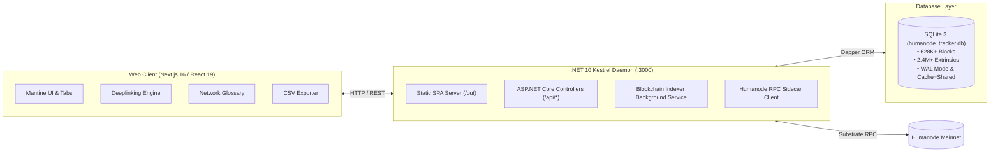

# 🧬 Humanode-Trace: Dual-Layer Explorer & Forensic Suite

> **High-Performance Blockchain Explorer, Forensic Money Trail, Biometric Validator Analytics & Tokenomics Suite for the Humanode Proof-of-Humanity Blockchain.**

[](https://dotnet.microsoft.com/)
[](https://nextjs.org/)
[](https://react.dev/)
[](https://sqlite.org/)
[-00D26A)](https://humanode.io/)
[](LICENSE)

---

## ⚡ Quick Start (TL;DR)

Get Humanode-Trace up and running in 3 simple commands:

```bash
# 1. Clone & Enter
git clone https://github.com/gulecfatih/Humanode-Trace.git && cd Humanode-Trace

# 2. Build Frontend
npm install && npm run build

# 3. Start Unified Server (.NET Kestrel serves both API & Frontend on :3000)
dotnet run --project backend
```

> Open [http://localhost:3000](http://localhost:3000) in your browser.

---

## ✨ Features

- **⚡ Dual-Layer Architecture:** Tracks native Substrate extrinsics (bioauth, session, vesting, tokenClaims) combined with EVM block tracking, internal transactions, and `0x0000000000000000000000000000000000000900` precompile swap bridge monitoring.
- **🧬 Proof-of-Humanity Validator Health:** Live 168-hour (42 Epoch) biometric countdown, cadence calculations, block authoring stats, and zero-stake equal validator rewards for all 89 active human nodes.
- **🔍 Forensic Money Trail & Deep Ledger:** Interactive transaction graph, multi-token portfolio engine (HMND, WeHMND, USDC), and complete historical ledger with CSV export capability.
- **🏛️ FeesPot & Economic Pool Analytics:** Real-time monitoring of validator distribution rounds, burn metrics, and inflation-free tokenomics (400,000,000 HMND fixed supply).
- **🌐 25+ Multi-Chain Biomapper Registry:** Verification and cross-chain identity feed across Ethereum, Arbitrum, Optimism, Linea, Base, Polygon, and more.
- **📖 Interactive Network Glossary:** Built-in modal guide explaining Proof-of-Humanity mechanics, bioauth countdowns, FeesPot, and EVM precompiles for non-technical users.
- **🔗 Shareable URLs & Deeplinking:** Browser query parameters sync in real-time (`?tab=validators`, `?tab=ledger&address=0x...`, `?block=628000`), allowing instant sharing across Telegram, Discord, and Twitter.
- **🌍 SQL-Driven Multi-Language Engine:** Dynamic i18n localization engine (Turkish, English, German, Russian, Spanish, Chinese) powered directly by SQLite tables (`app_languages`, `app_translations`).
- **📰 Financial Times Editorial Design (Theme 14):** Clean, high-contrast newspaper typography with serif headers, warm parchment palette, and ultra-readable data tables built for intensive financial reading.
- **🔄 Zero-Config Auto-Bootstrapping DB:** Self-initializing SQLite database from `database_schema.sql` on first launch with 6,990 translations and complete configuration.
- **⚡ Ultralight & Ultra-Fast:** Built with .NET 10 Kestrel (10,000+ req/sec capability, Dapper ORM) and Next.js 16 (React 19 + Mantine UI + Tabler Icons).

---

## 🏗️ Architecture



---

## 🛠️ Tech Stack

- **Backend:** .NET 10 (C#), ASP.NET Core Kestrel, Dapper ORM, `Microsoft.Data.Sqlite`
- **Frontend:** Next.js 16 (App Router, Static Export), React 19, Mantine UI v7, Tabler Icons, Recharts
- **Database:** SQLite 3 (`humanode_tracker.db` with WAL mode & memory-mapped I/O)
- **Node Integration:** Substrate RPC Sidecar client & automated block indexer background service

---

## 🚀 Getting Started

### Prerequisites

Ensure you have the following installed on your system:
- [.NET 10 SDK](https://dotnet.microsoft.com/) (`dotnet --version` >= 10.0)
- [Node.js 20+ & npm](https://nodejs.org/) (`node --version` >= 20.0)
- [Python 3.10+](https://www.python.org/) (for helper and audit scripts)

---

### Step 1: Clone the Repository

```bash
git clone https://github.com/gulecfatih/Humanode-Trace.git
cd Humanode-Trace
```

---

### Step 2: Database Setup (Choose Your Method)

The on-chain historical database contains over **630,000+ blocks**, **2.4M+ extrinsics**, and **33,000+ validator payout distributions** (~1.42 GB uncompressed). Because GitHub repositories limit individual file commits to 100 MB, the full database is distributed as an optimized, verified ZIP snapshot (~363 MB) via **GitHub Releases**.

Choose one of the following 3 options depending on your needs:

---

#### 🌟 Option A: Download Full Historical Snapshot (~363 MB) — *Recommended*

This gives you the complete historical blockchain archive from Genesis (Block #0) to the present, enabling instant analytics, deep ledger audits, and forensic graphs without waiting for indexing:

**Automated Downloader Script:**
```bash
python scripts/download_db.py
```
*This downloads `humanode_tracker_snapshot.zip` directly from the latest GitHub Release and automatically unzips `humanode_tracker.db` into the project root directory.*

**Manual Download Alternative:**
1. Navigate to the [Releases Page](https://github.com/gulecfatih/Humanode-Trace/releases).
2. Download `humanode_tracker_snapshot.zip`.
3. Extract `humanode_tracker.db` directly into the root folder of this repository.

---

#### ⚡ Option B: Zero-Config Automatic Bootstrap — *Instant Start*

If you don't need historical data immediately, you don't even need to download anything!

Simply launch the backend server:
```bash
dotnet run --project backend
```
- The backend's `SqliteConnectionFactory` automatically detects that `humanode_tracker.db` is missing.
- It automatically executes `database_schema.sql` in under **2 seconds**, creating all **19 tables**, **49 indexes**, **7 views**, and seeding all **6,990 multilingual translations** (TR, EN, DE, RU, ES, ZH), token metadata, and Biomapper cross-chain definitions.
- The built-in `BlockchainIndexerService` immediately begins syncing recent blocks live from the Humanode RPC sidecar!

---

#### 🛠️ Option C: Manual Schema Initialization via SQL

If you prefer to initialize the database manually before starting the backend:

**Cross-Platform (Python):**
```bash
python -c "import sqlite3; conn = sqlite3.connect('humanode_tracker.db'); conn.executescript(open('database_schema.sql', encoding='utf-8').read()); print('✅ Database initialized successfully!')"
```

**SQLite CLI:**
```bash
# Windows PowerShell
sqlite3 humanode_tracker.db ".read database_schema.sql"

# Linux / macOS
sqlite3 humanode_tracker.db < database_schema.sql
```

---

### Step 3: Install Dependencies & Build

#### 1. Restore & Build Backend (.NET 10):
```bash
dotnet restore backend
dotnet build backend
```

#### 2. Install & Export Frontend (Next.js 16):
```bash
npm install
npm run build
```
*This compiles the frontend and exports optimized static assets into the `out/` directory.*

---

### Step 4: Run the Application

#### Start the Unified .NET Server:
```bash
dotnet run --project backend
```

> **🎉 That's it!** The .NET Kestrel server starts on `http://localhost:3000` and serves **both the high-speed REST API (`/api/*`) and the static Next.js frontend** from a single unified port.

#### (Optional) Frontend Hot-Reload Development:
If you are developing frontend components and want instant hot-reloading:
```bash
npm run dev
```

---

## 🧪 Automated System Integrity Audit

Humanode-Trace includes a comprehensive automated end-to-end audit script that validates **19 critical system metrics** (database health, validator epoch countdowns, multi-asset token balances, bridge volume, and SQL translation endpoints):

```bash
# Make sure the backend is running on http://localhost:3000, then run:
python scripts/audit_system_full.py
```

Expected scorecard output:
```text
======================================================================
📊 DENETİM SONUÇ KARNESİ: Toplam 19 Kontrol
   ✅ BAŞARILI: 19
   ⚠️  UYARI:    0
   ❌ BAŞARISIZ: 0
======================================================================
Sonuçlar audit_results.json dosyasına kaydedildi.
```

---

## 📁 Repository Structure

```text
Humanode-Trace/
├── app/                       # Next.js App Router (Layout, Theme, SEO metadata)
│   ├── favicon.ico            # Official Humanode multi-resolution icon
│   ├── icon.png               # Official Humanode 48x48 web icon
│   └── apple-icon.png         # High-res 180x180 Apple touch icon
├── backend/                   # .NET 10 Web API & Daemon
│   ├── Controllers/           # REST API endpoints (Validators, Bridge, Stats, etc.)
│   ├── Repositories/          # Dapper SQLite data access layers
│   ├── Services/              # Blockchain indexer & Tokenomics sync workers
│   ├── Models/                # Strongly-typed DTO models
│   ├── Data/                  # Seed data & validator payouts JSON
│   └── appsettings.json       # Database connection & network RPC config
├── components/                # React Mantine UI Components
│   ├── ui/                    # Reusable atom components (AddressBadge, AmountDisplay)
│   ├── LanguageContext.jsx    # SQL-driven dynamic localization context
│   ├── NetworkGlossaryModal.jsx # Interactive Humanode concept guide & glossary
│   ├── formatters.js          # Currency, date, and client-side CSV export engine
│   └── *Tab.jsx               # Feature tabs (Overview, Validators, MoneyTrail, etc.)
├── scripts/                   # Management, migration & audit utilities
│   ├── download_db.py         # Automated release snapshot downloader
│   ├── export_db_snapshot.py  # High-ratio ZIP snapshot generator for releases
│   └── audit_system_full.py   # 19-point system health & integrity auditor
├── database_schema.sql        # Full DDL schema and language seed statements
├── next.config.mjs            # Next.js static export configuration
├── package.json               # Frontend dependencies & build scripts
├── LICENSE                    # Official MIT License terms
└── .gitignore                 # GitHub-compliant production ignore rules
```

---

## 📄 License

Distributed under the **MIT License**. Developed for the Humanode Community.
